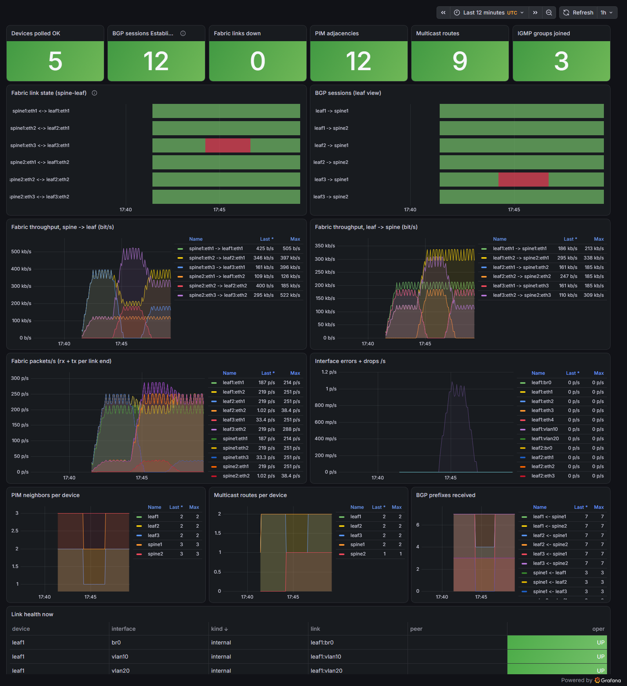
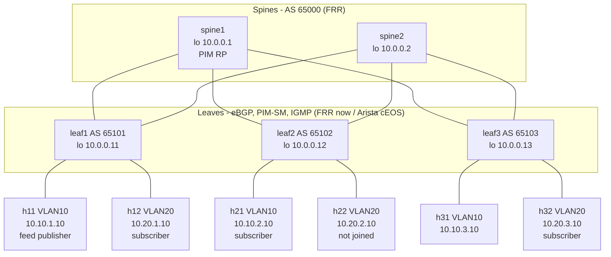

# Data Center Network Lab: Arista cEOS, FRRouting, Containerlab

A virtual spine-leaf data center fabric built with Containerlab. It covers
VLANs and inter-VLAN routing on the leaves, eBGP between spines and leaves
with ECMP, PIM sparse mode with IGMP so a market-data style multicast feed
reaches subscribers on different leaves, Python/Netmiko automation for config
backups and health checks, and Prometheus + Grafana link-health monitoring.

There are two variants of the same design:

| Variant | Topology file | Leaves | Spines | Status |
|---|---|---|---|---|
| **All-FRR** | `topologies/dc-frr.clab.yml` | FRR + Linux VLAN-aware bridge, SVIs | FRR | **Deployed and verified** (outputs in `docs/verification/`) |
| **cEOS** | `topologies/dc-ceos.clab.yml` | Arista cEOS (EOS configs in `configs/ceos/`) | FRR | **Prepared, needs the cEOS image** (see [cEOS variant](#ceos-variant-needs-the-image)) |



*Real capture of the provisioned dashboard while a 200 pkt/s multicast feed
and two ping streams were running. The red block in "Fabric link state" and
"BGP sessions" is leaf3 eth1 (uplink to spine1) being shut down from 17:44:03
to 17:46:30 UTC; the throughput graphs show leaf3 traffic moving to spine2.*

## Topology



Port map: `spineN:ethL <-> leafL:ethN` for the fabric; on every leaf `eth3` is
an access port in VLAN 10 and `eth4` an access port in VLAN 20 (`Ethernet1-4`
on cEOS).

### Design choices

- **cEOS on the leaves, FRR on the spines.** The leaf is where the
  feature-rich edge work happens: VLANs, SVIs as host gateways, IGMP snooping
  and the PIM designated router for the hosts. That is what a vendor switch
  OS is for. The spines in this design only route (eBGP + PIM transit + RP),
  which is a realistic job for an open routing stack such as FRR. It also
  keeps the lab lighter, because each cEOS container needs about 1 GB of RAM.
- **One shared ASN for the spines, one ASN per leaf** (RFC 7938 style).
  Leaf-to-leaf paths always go through a spine. A leaf's prefixes cannot come
  back to it via the other spine (AS-path loop prevention). Routes learned
  from both spines have the same AS path, so plain `maximum-paths` gives
  ECMP.
- **/31 point-to-point links, /32 loopbacks, one /24 per VLAN per leaf.**
  The leaves are routed (L3 leaf, no VXLAN), so each leaf owns its VLAN
  subnets and advertises them with `network` statements.
- **Static RP on spine1's loopback (10.0.0.1)** for 239.0.0.0/8, configured
  the same way on every router. IGMPv3 runs on the host-facing SVIs.

### Addressing and ASN plan

| Node | ASN | Loopback | Fabric links | VLAN 10 SVI | VLAN 20 SVI | Mgmt (FRR / cEOS lab) |
|---|---|---|---|---|---|---|
| spine1 | 65000 | 10.0.0.1/32 (RP) | eth1-3: 10.1.1.0, .2, .4 /31 | - | - | 172.30.30.11 / 172.40.40.11 |
| spine2 | 65000 | 10.0.0.2/32 | eth1-3: 10.1.2.0, .2, .4 /31 | - | - | 172.30.30.12 / 172.40.40.12 |
| leaf1 | 65101 | 10.0.0.11/32 | eth1 10.1.1.1, eth2 10.1.2.1 | 10.10.1.1/24 | 10.20.1.1/24 | 172.30.30.21 / 172.40.40.21 |
| leaf2 | 65102 | 10.0.0.12/32 | eth1 10.1.1.3, eth2 10.1.2.3 | 10.10.2.1/24 | 10.20.2.1/24 | 172.30.30.22 / 172.40.40.22 |
| leaf3 | 65103 | 10.0.0.13/32 | eth1 10.1.1.5, eth2 10.1.2.5 | 10.10.3.1/24 | 10.20.3.1/24 | 172.30.30.23 / 172.40.40.23 |

| Host | Leaf / VLAN | Address | Gateway | Multicast role |
|---|---|---|---|---|
| h11 | leaf1 / 10 | 10.10.1.10/24 | 10.10.1.1 | publisher to 239.1.1.1:5001 |
| h12 | leaf1 / 20 | 10.20.1.10/24 | 10.20.1.1 | subscriber (same leaf, other VLAN) |
| h21 | leaf2 / 10 | 10.10.2.10/24 | 10.10.2.1 | subscriber |
| h22 | leaf2 / 20 | 10.20.2.10/24 | 10.20.2.1 | control: does not join |
| h31 | leaf3 / 10 | 10.10.3.10/24 | 10.10.3.1 | - |
| h32 | leaf3 / 20 | 10.20.3.10/24 | 10.20.3.1 | subscriber |

## Repository layout

```
topologies/        dc-frr.clab.yml (runs now), dc-ceos.clab.yml (needs cEOS)
configs/frr/       frr.conf per router, daemons, sysctl.sh, leaf l2-setup.sh (bridge/VLANs)
configs/ceos/      EOS startup configs for the cEOS leaves
images/            frr-ssh (FRR + sshd for Netmiko), host (alpine + python3), automation
apps/mcast/        publisher.py / subscriber.py (UDP multicast feed with sequence numbers)
automation/        Netmiko automation: inventory, parsers, checks, backup, CLI, tests
inventory/         frr-lab.yml, ceos-lab.yml (devices + expected state)
monitoring/        exporter (prometheus_client), Prometheus config, Grafana provisioning
scripts/           clab.sh, verify.sh, automation.sh, demo-traffic.sh, grafana-screenshot.ps1
docs/verification/ real CLI output captured from the running lab
docs/automation/   real backup/check runs (healthy and with a link shut down)
```

## Running the all-FRR lab

You need Docker. Nothing else has to be installed on the workstation:
containerlab runs from its container image through `scripts/clab.sh`. On
Windows, use Git Bash with Docker Desktop (Linux engine). The wrapper maps the
lab directory to the path the Docker Desktop VM uses
(`/run/desktop/mnt/host/<drive>/...`) so containerlab's bind mounts resolve.

```bash
# 1. build the three small images
docker build -t dclab/frr-ssh:10.2.1 images/frr-ssh
docker build -t dclab/host:1.0 images/host
docker build -t dclab/automation:1.0 -f images/automation/Dockerfile .

# 2. deploy (about 30 s)
scripts/clab.sh deploy -t topologies/dc-frr.clab.yml

# 3. verify everything end to end and refresh docs/verification/
scripts/verify.sh

# poke around
docker exec -it clab-dc-frr-leaf1 vtysh
docker exec -it clab-dc-frr-h11 sh

# 4. destroy
scripts/clab.sh destroy -t topologies/dc-frr.clab.yml --cleanup
```

On Linux with containerlab installed, `sudo containerlab deploy -t topologies/dc-frr.clab.yml` works the same way.

### How the FRR leaves do VLANs

`configs/frr/leafN/l2-setup.sh` runs inside each leaf after the links exist
(containerlab `exec`). It creates a VLAN-aware Linux bridge `br0` with
`eth3` as an untagged access port in VLAN 10 and `eth4` in VLAN 20, with IGMP
snooping enabled. It then adds two VLAN subinterfaces of the bridge,
`vlan10` and `vlan20`, which act as the SVIs. FRR (`frr.conf`) owns all layer-3
config on those SVIs: gateway addresses, `ip pim`, `ip igmp`. So routing
between VLAN 10 and VLAN 20 on a leaf, and between leaves over eBGP, is done
by the leaf exactly like an L3 switch.

## Verification (real output)

`scripts/verify.sh` captures all of these into `docs/verification/`. The
excerpts below are from the run committed in this repository.

**eBGP: all 6 spine-leaf sessions Established** (`01-bgp-summary.txt`)

```
===== leaf1 : show ip bgp summary =====
BGP router identifier 10.0.0.11, local AS number 65101 VRF default vrf-id 0
Neighbor         V         AS   MsgRcvd   MsgSent   TblVer  InQ OutQ  Up/Down State/PfxRcd   PfxSnt Desc
spine1(10.1.1.0) 4      65000         9        10       17    0    0 00:00:07            7       11 spine1
spine2(10.1.2.0) 4      65000         9        10       17    0    0 00:00:09            7       11 spine2
```

**ECMP across both spines, in FRR and in the kernel FIB** (`02-ip-route.txt`)

```
===== leaf1 : show ip route 10.10.3.0/24 (ECMP over both spines) =====
Routing entry for 10.10.3.0/24
  Known via "bgp", distance 20, metric 0, best
  Last update 00:00:09 ago
  * 10.1.1.0, via eth1, weight 1
  * 10.1.2.0, via eth2, weight 1

===== leaf1 : ip route show 10.10.3.0/24 (kernel FIB) =====
10.10.3.0/24 nhid 37 proto bgp metric 20
	nexthop via 10.1.2.0 dev eth2 weight 1
	nexthop via 10.1.1.0 dev eth1 weight 1
```

**Inter-VLAN routing, on one leaf and across the fabric** (`04-ping-inter-vlan.txt`)

```
===== h11 -> 10.20.1.10 : inter-VLAN on leaf1 (VLAN10 -> VLAN20) =====
3 packets transmitted, 3 received, 0% packet loss, time 2033ms
===== h11 -> 10.20.3.10 : leaf1 VLAN10 -> leaf3 VLAN20 (across the fabric, inter-VLAN) =====
3 packets transmitted, 3 received, 0% packet loss, time 2031ms
===== h11 : traceroute 10.20.3.10 =====
 1  10.10.1.1  0.067 ms      <- leaf1 VLAN10 SVI
 2  10.1.1.0  0.005 ms       <- spine1
 3  10.1.1.5  0.003 ms       <- leaf3
 4  10.20.3.10  0.003 ms     <- h32
```

**PIM neighbors and RP** (`05-pim-neighbor-rp.txt`)

```
===== spine1 : show ip pim neighbor =====
 Interface  Neighbor  Uptime    Holdtime  DR Pri
 eth1       10.1.1.1  00:00:46  00:01:32  1
 eth2       10.1.1.3  00:00:46  00:01:32  1
 eth3       10.1.1.5  00:00:46  00:01:32  1
===== spine1 : show ip pim rp-info =====
 RP address  group/prefix-list  OIF  I am RP  Source  Group-Type
 10.0.0.1    239.0.0.0/8        lo   yes      Static  ASM
```

**IGMP group membership and the snooping table** (`06-igmp-groups.txt`)

```
===== leaf2 : show ip igmp groups =====
Interface        Group           Mode Timer    Srcs V Uptime
vlan10           239.1.1.1       EXCL 00:04:01    1 3 00:00:29
===== leaf2 : bridge mdb show (IGMP snooping table) =====
dev br0 port eth3 grp 239.1.1.1 temp vid 10
```

**Multicast routes: shared tree from the RP, kernel forwarding cache** (`07-mroute.txt`)

```
===== spine1 : show ip mroute =====
 Source      Group      Flags  Proto  Input  Output  TTL  Uptime
 *           239.1.1.1  S      PIM    lo     eth1    1    00:00:32
                               PIM           eth2    1
                               PIM           eth3    1
 10.10.1.10  239.1.1.1  SRT    STAR   eth1   eth2    1    00:00:24
                               STAR          eth3    1
===== leaf2 : ip mroute show (kernel multicast forwarding cache) =====
(0.0.0.0,239.1.1.1)              Iif: eth1       Oifs: pimreg vlan10 eth1  State: resolved
(10.10.1.10,239.1.1.1)           Iif: eth1       Oifs: vlan10  State: resolved
===== leaf2 : show ip mroute count =====
 Source      Group      LastUsed  Packets  Bytes  WrongIf
 10.10.1.10  239.1.1.1  2         599      65359  0
```

**The same feed received on three subscribers on different leaves** (`08-multicast-receive.txt`)

```
feed: h11 (10.10.1.10, leaf1 VLAN10) -> 239.1.1.1:5001, 20 pkt/s, 600 packets
{"role": "publisher", "group": "239.1.1.1", "sent": 600, "seconds": 30.0}
{"role": "subscriber", "host": "h21", "group": "239.1.1.1", "received": 600, "first_seq": 1, "last_seq": 600, "gaps": 0, "senders": ["10.10.1.10"]}
{"role": "subscriber", "host": "h32", "group": "239.1.1.1", "received": 600, "first_seq": 1, "last_seq": 600, "gaps": 0, "senders": ["10.10.1.10"]}
{"role": "subscriber", "host": "h12", "group": "239.1.1.1", "received": 599, "first_seq": 2, "last_seq": 600, "gaps": 0, "senders": ["10.10.1.10"]}
===== h22 : control host (no IGMP join), packets seen on the wire =====
0
```

h21 (leaf2) and h32 (leaf3) got all 600 packets. h12 (leaf1, other VLAN)
missed only packet #1, which arrived before the (S,G) entry was installed.
h22 sits in a VLAN with no listener and saw nothing, which shows that PIM only
forwards onto SVIs with IGMP members and that the bridge's snooping table
limits flooding.

**Link failure** (`09-link-failure.txt`): with leaf3's uplink to spine1 shut,
the BGP session drops to `Active`, the leaf's routes fall back to spine2 only,
unicast keeps working, and the feed keeps flowing to h32 over the source tree
through spine2 (978 packets in 5 s, the same as h21).

### Multicast, step by step

1. **IGMP join.** A subscriber opens a socket and calls `IP_ADD_MEMBERSHIP`
   for 239.1.1.1. The host sends an IGMPv3 membership report. The leaf's
   bridge snoops it (entry in `bridge mdb`, so the group is only forwarded to
   that port). The leaf's SVI is the IGMP querier and records the group
   (`show ip igmp groups`).
2. **Shared tree toward the RP.** As the PIM DR for that VLAN, the leaf
   creates `(*,239.1.1.1)` and sends a PIM (*,G) join hop by hop toward the RP
   (10.0.0.1, spine1), following its unicast route to the RP (RPF). Spine1
   adds the leaf-facing interface to the outgoing list of its (*,G)
   (`show ip pim join`).
3. **Source registration.** When h11 starts sending, its leaf (the source's
   DR) encapsulates the first packets in PIM Register messages to the RP.
   The RP decapsulates them, forwards them down the shared tree, and joins
   (S,G) back toward the source. After that, traffic flows natively
   (spine1 `(10.10.1.10, 239.1.1.1)` flags `SRT`).
4. **Replication.** Spine1 copies each packet onto every leaf link with
   downstream joins. Each receiving leaf routes it onto the SVI with members,
   and the bridge delivers it only to the ports that joined. One packet from
   the publisher becomes one copy per interested leaf and per interested VLAN,
   never one per subscriber at the source.
5. **SPT.** Leaves can switch to the shortest-path tree toward the source.
   Here the source path and the RP path usually match (both via spine1). When
   leaf3's link to spine1 was shut, leaf3 kept receiving on an (S,G) entry
   with the T flag through spine2.

Kernel support: Docker Desktop's WSL2 kernel (6.18) has `CONFIG_IP_MROUTE`,
`CONFIG_IP_PIMSM_V2` and `CONFIG_BRIDGE_IGMP_SNOOPING`. pimd programs the
kernel MFC (`ip mroute show`), and the kernel does the forwarding. The FRR
containers run as containerlab `linux` nodes (privileged). `sysctl.sh` turns
on forwarding and turns off `rp_filter`, because strict reverse-path
filtering would drop multicast arriving over the "other" ECMP uplink.

## Automation (Netmiko)

`automation/` is a small package. It runs in the `dclab/automation` container
on the lab management network:

```bash
scripts/automation.sh backup -i inventory/frr-lab.yml     # running configs -> backups/<UTC timestamp>/<device>.cfg
scripts/automation.sh check  -i inventory/frr-lab.yml     # report + exit code (0 ok, 1 failed, 2 usage error)
scripts/automation.sh check  -i inventory/frr-lab.yml --json /lab/backups/check.json
scripts/automation.sh pytest -q                            # unit tests
```

- **Transport.** FRR nodes run sshd (image `images/frr-ssh`, lab user
  `netops`). Netmiko connects with `device_type: linux` and runs
  `vtysh -c '... json'` for routing state and `ip -j -s link` for interface
  state and counters. cEOS nodes use `device_type: arista_eos` and the EOS
  CLI with `| json`. The command catalogue lives in
  `automation/platforms.py`, and the parsers turn both vendors' JSON into the
  same structures.
- **check** compares live state against the `expect:` block for each device
  in the inventory: every BGP neighbor Established, exact received prefix
  count per neighbor, the listed interfaces admin up and oper up, and the
  number of PIM neighbors.
- **backup** saves `show running-config` per device with preamble lines
  stripped, LF line endings, into a timestamped directory.

Real runs are in `docs/automation/`:

```
$ scripts/automation.sh check -i inventory/frr-lab.yml        # healthy
...
leaf1   bgp_session    10.1.1.0 (spine1)  PASS    Established, AS 65000
leaf1   bgp_prefixes   10.1.1.0 (spine1)  PASS    received 7, expected 7
leaf1   interface      vlan10             PASS    up, errors 0
leaf1   pim_neighbors  count              PASS    2 (expected 2): 10.1.1.0@eth1, 10.1.2.0@eth2
61 passed, 0 failed -> OK                                          (exit 0)

# after: leaf3# interface eth1 / shutdown
spine1  bgp_session    10.1.1.5 (leaf3)   FAIL    state Active
spine1  interface      eth3               FAIL    admin up, oper down
spine1  pim_neighbors  count              FAIL    2 (expected 3): 10.1.1.1@eth1, 10.1.1.3@eth2
leaf1   bgp_prefixes   10.1.1.0 (spine1)  FAIL    received 4, expected 7
leaf3   interface      eth1               FAIL    admin down
51 passed, 8 failed -> FAILED                                      (exit 1)
```

**Tests.** 42 pytest unit tests cover the parsers, the check logic, the
inventory, report rendering, backups, CLI exit codes and the exporter. The
FRR test inputs in `automation/tests/fixtures/frr/` are real outputs recorded
from the running lab, including captures taken while leaf3 eth1 was down.
The EOS inputs in `fixtures/eos/` are hand-made samples in the eAPI JSON
layout; replace them with real captures once the cEOS lab is up.

## Monitoring (Prometheus + Grafana)

```bash
docker compose -f monitoring/docker-compose.yml up -d     # needs the lab's mgmt network (deploy first)
scripts/demo-traffic.sh start                              # optional: 200 pkt/s feed + ping streams
# Grafana   http://localhost:3000/d/dc-fabric   (anonymous viewer; admin/admin to edit)
# Prometheus http://localhost:9090   exporter http://localhost:9500/metrics
docker compose -f monitoring/docker-compose.yml down
```

- `monitoring/exporter/exporter.py` uses the same automation layer as
  `check`. It runs one poller thread per device with a persistent SSH session,
  polls every 5 s, and serves the cached state on `:9500`. It reads the
  containerlab topology so every interface metric carries `link`, `peer` and
  `kind` (fabric/access) labels.
- Metrics: `dclab_interface_oper_up`, `dclab_interface_admin_up`,
  `dclab_interface_{rx,tx}_{bytes,packets,errors,dropped}_total` (counters;
  Grafana graphs `rate()`), `dclab_bgp_session_established`,
  `dclab_bgp_prefixes_received`, `dclab_pim_neighbors`,
  `dclab_mroutes{type="sg|star_g"}`, `dclab_igmp_groups`, `dclab_device_up`,
  `dclab_poll_duration_seconds`.
- The dashboard is provisioned from
  `monitoring/grafana/dashboards/dc-fabric.json`, which is built by
  `monitoring/grafana/build_dashboard.py` (CI checks that they match). Panels:
  summary stats, fabric link state timeline, BGP session timeline, per-link
  throughput in both directions, packets/s, errors and drops, PIM neighbors,
  mroutes, prefixes received, and a current link-health table.
- Screenshot: `scripts/grafana-screenshot.ps1` (headless Microsoft Edge on
  Windows) produced `docs/img/grafana-dc-fabric.png`.

## cEOS variant (needs the image)

`topologies/dc-ceos.clab.yml` uses the same addressing, ASNs, hosts and FRR
spine configs. Only the leaves change, to Arista cEOS with the startup configs
in `configs/ceos/leaf{1,2,3}.cfg`:

- `vlan 10/20`, `Ethernet3/4` as `switchport access`, `Ethernet1/2` as
  routed `no switchport` /31 uplinks
- `interface Vlan10/Vlan20` SVIs with `ip igmp` and `pim ipv4 sparse-mode`,
  plus `ip routing`
- `ip igmp snooping` for both VLANs
- `router bgp 6510x` with a `SPINES` peer group and `maximum-paths 4 ecmp 4`
- `router multicast / ipv4 / routing` and
  `router pim sparse-mode / ipv4 / rp address 10.0.0.1 239.0.0.0/8`

Once you have the image (Arista account, cEOS-lab download, for example
`E:\google downloads\cEOS64-lab-<ver>.tar.xz`):

```bash
docker import "/e/google downloads/cEOS64-lab-<ver>.tar.xz" ceos:<ver>
export CEOS_VERSION=<ver>                       # the topology uses ceos:${CEOS_VERSION:=4.33.1F}
scripts/clab.sh deploy -t topologies/dc-ceos.clab.yml   # wait 1-2 min for EOS to boot
docker exec -it clab-dc-ceos-leaf1 Cli          # show ip bgp summary / show ip pim neighbor / show ip igmp groups
LAB=dc-ceos MGMT_NET=dclab-ceos-mgmt scripts/automation.sh check -i inventory/ceos-lab.yml
scripts/clab.sh destroy -t topologies/dc-ceos.clab.yml --cleanup
```

`scripts/verify.sh` calls `vtysh` on every router, so for the cEOS lab run
the EOS equivalents with `docker exec clab-dc-ceos-leafN Cli -c "<command>"`
for the leaves. The host-side multicast steps (`apps/mcast`) are unchanged.
The EOS configs have not been booted yet. Expect to fix small things on the
first deploy and then refresh the EOS test fixtures with real output.

## CI

`.github/workflows/ci.yml`:

- **lint-and-test**: yamllint, shellcheck, `vtysh -C` syntax check of every
  `frr.conf` in the FRR image, a check that the dashboard JSON matches its
  generator, and pytest.
- **lab**: installs containerlab on `ubuntu-latest`, builds the images,
  deploys `dc-frr`, runs `scripts/verify.sh` and the automation `check` and
  `backup`, uploads the outputs as an artifact, and destroys the lab.

## Known limitations

- The RP is a single static RP on spine1. Because the spines share AS 65000,
  spine1's loopback is only reachable over each leaf's direct link to spine1.
  If that link fails, the leaf loses the RP: existing (S,G) trees keep working
  through spine2 (shown in `09-link-failure.txt`), but new sources or groups
  would not. Production would use Anycast-RP (PIM or MSDP) on both spines.
- The cEOS variant is untested until the image is available. The EOS parser
  fixtures are samples, not captures.
- `rp_filter` is disabled on the FRR routers. That is normal for a multicast
  router with ECMP uplinks, but worth knowing.
